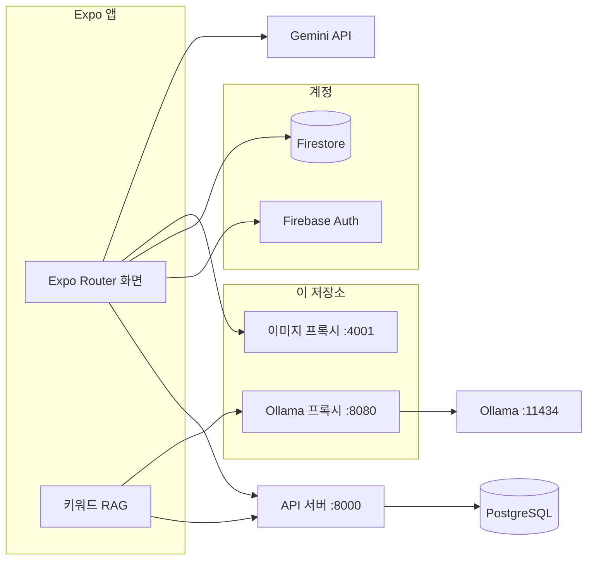

## Team 안진마

**`@do-ttery` : UI/UX 기획 및 디자인, 프론트엔드 개발**

**`@cheoleon` : 백엔드 개발 담당**

**`@M-SE0K` : 풀스택 개발 담당**

프로젝트 진행 중 풀스택 개발을 담당하여, 크롤러를 제외한 기획과 개발을 진행했습니다.

**배포 URL:** http://113.198.66.75:18016/

## 프로젝트 소개

🏆 2025년 오픈소스 SW 아이디어 해커톤 캠프 장려상

🏆 2025년 전북대학교 컴퓨터인공지능학부 작품경진대회 대상

**AI 기반 전북권 대학 및 SW 사업단 통합 정보 플랫폼**

전북권 대학(전북대, 군산대, 원광대)과 SW 사업단의 행사·공지를 한곳에서 보는 Expo 앱입니다. 웹, iOS, Android를 같은 코드로 제공합니다.

공지, 배너, 기관, 이벤트는 PostgreSQL에 있고, API 서버가 조회해 앱에 내려줍니다. 챗봇은 그 공지를 키워드로 찾아 맥락을 만든 뒤 Ollama로 답합니다. 포스터·본문 요약과 태그 추정에는 Gemini를 사용합니다. 로그인, 즐겨찾기, 관심 태그, 조회수는 Firebase를 사용합니다.

### Framework

<span></span>
<span></span>
<span></span>
<span></span>
<span></span>
<span></span>
<span></span>
<span></span>
<span></span>
<span></span>

| 구분 | 사용 |
|------|------|
| 앱 | Expo SDK 54, React Native 0.81, React 19, Expo Router, TanStack Query, Zod |
| 콘텐츠 조회 | API 서버 (`EXPO_PUBLIC_API_BASE_URL`, 로컬 기본 `http://localhost:8000`) |
| 콘텐츠 저장 | PostgreSQL. API 서버가 읽어서 JSON으로 응답 |
| 계정·개인 데이터 | Firebase Auth, Firestore (즐겨찾기, 관심 태그, 조회수) |
| 챗봇 | 키워드 RAG + Express Ollama 프록시(`:8080`) + Ollama `llama3.1:8b` |
| 요약·태그 | Gemini `gemini-2.0-flash-lite` |
| 이미지 | Express 이미지 프록시(`:4001`) |
| 웹 배포 | Expo 정적 export, Nginx, Docker |

## 아키텍처

앱은 공지와 배너를 PostgreSQL에 직접 붙지 않고 API 서버로 요청합니다. API 서버가 PostgreSQL을 조회한 뒤 `{ data: [...] }` 형태로 돌려줍니다. 이 저장소의 Express는 채팅·이미지 프록시이며, 콘텐츠 API와 별개입니다.



### API 서버가 내려주는 데이터

| 요청 | 앱에서 쓰는 곳 |
|------|----------------|
| `GET /notices?limit=` | 홈, 소식, 인기 후보, 챗봇 검색 대상, 새 글 알림 폴링 |
| `GET /notices/banners?limit=` | 이미지가 있는 공지 배너 |
| `GET /events`, `GET /events/:id` | 이벤트 목록·상세 |
| `GET /orgs` | 기관 목록 |
| `GET /search` | 검색 |
| `POST /devices` | 푸시 토큰 등록 |

공지 한 건은 `id`, `title`, `author`, `date`, `content_html`, `url`, `category`, `views`, `crawled_at`, `image_urls`, `attachments`를 포함합니다. 앱은 HTML·크롤 원문을 화면용 텍스트로 정제한 뒤 그립니다.

챗봇은 API로 받은 공지 제목·본문을 `src/api/rag.ts`에서 키워드 점수로 줄여 상위 5건을 Ollama 프롬프트에 넣습니다.

### 배포

`main` 푸시 시 GitHub Actions가 SSH로 서버에 접속해 컨테이너 두 개를 다시 띄웁니다. API 서버와 PostgreSQL은 이 워크플로 밖에 있으며, 앱 빌드에 넣는 `EXPO_PUBLIC_API_BASE_URL`로 연결합니다.

| 컨테이너 | 이미지 | 역할 |
|----------|--------|------|
| `frontend-server` | `Dockerfile` | Expo 웹 빌드를 Nginx로 제공 |
| `proxy-server` | `Dockerfile.proxy` | `/api/ollama/chat`으로 Ollama에 전달 |

웹 이미지는 빌드 시 `EXPO_PUBLIC_PROXY_URL`, `EXPO_PUBLIC_OLLAMA_MODEL`을 넣습니다. 프록시 컨테이너는 `PORT=8080`, `OLLAMA_URL`로 Ollama에 붙습니다.

### 디렉터리

```
app/                     Expo Router 화면
  index.tsx              홈
  events/                소식, 상세
  hot/                   인기
  chat/                  챗봇
  favorites/             저장
  search/                검색
  notification/          알림, 알림 설정
  settings/              설정
  auth/                  로그인, 회원가입
  orgs/                  기관
src/
  api/client.ts          API 서버 axios 클라이언트
  api/eventsFirestore.ts 공지·배너 조회와 본문 정제
  api/rag.ts             챗봇용 키워드 검색
  api/gemini/            포스터·텍스트 분석
  services/              인증, 즐겨찾기, 조회수, 알림
  db/firebase.tsx        Firebase Auth·Firestore 초기화
server/
  proxy.js               Ollama 프록시
  imageProxy.js          이미지 프록시
Dockerfile               웹 (Nginx)
Dockerfile.proxy         Ollama 프록시
```

## 주요 기능

| 기능 | 설명 |
|------|------|
| **홈** | API 서버의 공지를 최신순으로 표시. 배너는 `/notices/banners` |
| **소식** | 같은 공지 목록. 태그·키워드 필터, 상세와 원문 링크 |
| **인기** | Firestore `hotClicks` 조회수 기준 랭킹. 본문은 API 공지 |
| **챗봇** | API 공지를 키워드로 최대 5건 찾아 Ollama가 답변. 웹에서는 바로가기 오버레이 |
| **저장** | 로그인 사용자 즐겨찾기. Firestore `users/{uid}.favorites` |
| **알림** | API 공지의 `crawled_at`을 폴링해 로컬 알림. 관심 태그는 Firestore |
| **검색** | 목록 안 키워드 검색과 최근 검색어. `/search` 응답이 없으면 목 데이터 |
| **설정** | 관심 태그, 알림, 계정 |
| **인증** | 이메일·Google 로그인. `/auth/login`, `/auth/signup` 외 경로는 로그인 필요 |

## 개발환경 구축 및 실행

Node.js 20, npm, PostgreSQL이 연결된 API 서버, Ollama가 필요합니다. iOS·Android 네이티브 실행은 Expo 개발 클라이언트 환경이 추가로 필요합니다.

### 프로젝트 클론

```bash
git clone https://github.com/M-SE0K/JBSW-NOW.git
cd JBSW-NOW
```

### 필수 패키지 설치

```bash
npm install
```

의존성 설치, `.env` 키 보강, Expo 점검까지 한 번에 하려면 `npm run setup`을 실행합니다.

### 환경변수 설정

```bash
cp .env.example .env
```

루트 `.env` 하나를 Expo 앱, Ollama 프록시(`npm run proxy`), 이미지 프록시(`npm run proxylocal`), 스크립트가 함께 읽습니다.

| 변수 | 용도 |
|------|------|
| `EXPO_PUBLIC_API_BASE_URL` | PostgreSQL을 조회하는 API 서버. 로컬 기본값 `http://localhost:8000` |
| `EXPO_PUBLIC_PROXY_URL` | 앱이 호출하는 Ollama 프록시. 로컬 `http://localhost:8080` |
| `EXPO_PUBLIC_OLLAMA_MODEL` | 챗봇 모델. 기본 `llama3.1:8b` |
| `EXPO_PUBLIC_IMAGE_PROXY` | 원격 이미지 프록시 URL |
| `EXPO_PUBLIC_FIREBASE_*` | 로그인, 즐겨찾기, 관심 태그, 조회수 |
| `EXPO_PUBLIC_GOOGLE_*_CLIENT_ID` | Google 로그인 |
| `EXPO_PUBLIC_GEMINI_API_KEY` | 포스터·본문 분석 |
| `PORT`, `OLLAMA_URL`, `MAX_CONCURRENT_REQUESTS` | `server/proxy.js` |
| `IMAGE_PROXY_PORT` | `server/imageProxy.js`. 기본 `4001` |

Ollama 모델이 없으면 `npm run ollama:pull`로 받습니다.

### 실행

API 서버를 먼저 띄운 뒤, 프록시와 앱을 실행합니다. API 서버와 PostgreSQL은 이 저장소 밖에 있습니다.

```bash
# Ollama 챗봇 프록시 (기본 :8080)
npm run proxy

# 로컬 이미지 프록시 (기본 :4001)
npm run proxylocal

# Expo 개발 서버
npm run start
# i : iOS 시뮬레이터
# a : Android 에뮬레이터
# w : 웹
```

프록시 상태 확인: `GET http://localhost:8080/health`  
공지 조회 확인: `GET http://localhost:8000/notices?limit=5`

### 웹 배포 이미지

```bash
docker build \
  --build-arg EXPO_PUBLIC_PROXY_URL="$EXPO_PUBLIC_PROXY_URL" \
  --build-arg EXPO_PUBLIC_OLLAMA_MODEL="$EXPO_PUBLIC_OLLAMA_MODEL" \
  -t my-frontend .

docker build -f Dockerfile.proxy -t my-proxy .
```

`main` 브랜치에 푸시하면 `.github/workflows/deploy.yml`이 서버에서 `frontend-server`, `proxy-server`를 교체합니다.
