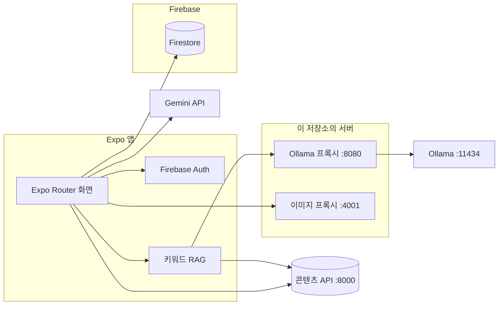

## Team 안진마

**`@do-ttery` : UI/UX 기획 및 디자인, 프론트엔드 개발**

**`@cheoleon` : 백엔드 개발 담당**

**`@M-SE0K` : 풀스택 개발 담당**

프로젝트 진행 중 풀스택 개발을 담당하여, 크롤러를 제외한 기획과 개발을 진행했습니다.

**배포 URL:** http://113.198.66.75:18016/

## 프로젝트 소개

🏆 2025년 오픈소스 SW 아이디어 해커톤 캠프 장려상

🏆 2025년 전북대학교 컴퓨터인공지능학부 작품경진대회 대상

**AI 기반 전북권 대학 및 SW 사업단 통합 정보 플랫폼**

전북권 대학(전북대, 군산대, 원광대)과 SW 사업단의 행사·공지를 한곳에서 보는 Expo 앱입니다. 웹, iOS, Android를 같은 코드로 제공합니다.

수집된 공지와 배너는 콘텐츠 API에서 읽고, 로그인·즐겨찾기·관심 태그·조회수는 Firebase에 둡니다. 챗봇은 공지를 키워드로 찾아 맥락을 만든 뒤 Ollama로 답합니다. 포스터·본문 요약과 태그 추정에는 Gemini를 사용합니다.

### Framework

<span></span>
<span></span>
<span></span>
<span></span>
<span></span>
<span></span>
<span></span>
<span></span>
<span></span>
<span></span>
<span></span>

| 구분 | 사용 |
|------|------|
| 앱 | Expo SDK 54, React Native 0.81, React 19, Expo Router |
| 상태·검증 | TanStack Query, Zod |
| 계정·사용자 데이터 | Firebase Auth, Cloud Firestore |
| 공지·배너 | 콘텐츠 API (`EXPO_PUBLIC_API_BASE_URL`) |
| 챗봇 | 키워드 RAG + Express Ollama 프록시 + Ollama (`llama3.1:8b`) |
| 요약·태그 | Gemini `gemini-2.0-flash-lite` |
| 웹 배포 | Expo 정적 export, Nginx |
| 프록시 | Express 5 (채팅 `:8080`, 이미지 `:4001`) |

## 아키텍처

로그인·회원가입을 제외한 화면은 Firebase Auth가 필요합니다. 홈·소식·챗봇이 읽는 공지 원문은 콘텐츠 API입니다. 조회수(`hotClicks`), 즐겨찾기와 관심 태그(`users`)는 Firestore에 저장합니다.



배포는 `main` 푸시 시 GitHub Actions가 SSH로 서버에 접속해 컨테이너 두 개를 다시 띄웁니다.

| 컨테이너 | 이미지 | 역할 |
|----------|--------|------|
| `frontend-server` | `Dockerfile` | Expo 웹 빌드 결과를 Nginx로 제공 |
| `proxy-server` | `Dockerfile.proxy` | `/api/ollama/chat`으로 Ollama에 전달 |

웹 이미지는 빌드 시 `EXPO_PUBLIC_PROXY_URL`, `EXPO_PUBLIC_OLLAMA_MODEL`을 넣습니다. 프록시 컨테이너는 `PORT=8080`, `OLLAMA_URL`로 Ollama에 붙습니다.

### 데이터 역할

| 저장소 | 쓰는 곳 |
|--------|---------|
| 콘텐츠 API `GET /notices` | 홈, 소식, 인기 후보, 챗봇 검색, 새 글 알림 폴링 |
| 콘텐츠 API `GET /notices/banners` | 공지 배너 |
| Firestore `users` | 즐겨찾기, 관심 태그 |
| Firestore `hotClicks` | 게시물 조회수 |
| Firestore `notifications`, `bannerImage` | 알림 문서, 배너 이미지 |
| Firestore `events` | Gemini로 분석한 포스터·텍스트 수집 결과 |

챗봇은 `src/api/rag.ts`에서 공지 제목·본문을 키워드로 점수화해 상위 문서를 고릅니다. `src/api/rag-vector.ts`는 임베딩 조회를 하지 않고 빈 목록을 반환합니다.

### 디렉터리

```
app/                     Expo Router 화면
  index.tsx              홈
  events/                소식, 상세
  hot/                   인기
  chat/                  챗봇
  favorites/             저장
  search/                검색
  notification/          알림, 알림 설정
  settings/              설정
  auth/                  로그인, 회원가입
  orgs/                  기관
src/
  api/                   콘텐츠 API, 챗봇, RAG, Gemini
  components/            화면 컴포넌트
  services/              인증, 즐겨찾기, 조회수, 알림
  db/firebase.tsx        Firebase 초기화
  state/queryClient.tsx  TanStack Query
server/
  proxy.js               Ollama 프록시
  imageProxy.js          이미지 프록시
scripts/                 환경 세팅, 모델 다운로드, 점검
Dockerfile               웹 (Nginx)
Dockerfile.proxy         Ollama 프록시
```

## 주요 기능

| 기능 | 설명 |
|------|------|
| **홈** | 콘텐츠 API 공지를 최신순으로 표시. 이미지가 있는 공지는 배너로 노출 |
| **소식** | 기관 공지 목록. 태그·키워드 필터, 상세와 원문 링크 |
| **인기** | `hotClicks` 조회수 기준 랭킹. 본문은 콘텐츠 API 공지 |
| **챗봇** | 관련 공지를 키워드로 최대 5건 찾아 프롬프트에 넣고 Ollama가 답변. 웹에서는 바로가기 오버레이 |
| **저장** | 로그인 사용자 즐겨찾기. Firestore `users/{uid}.favorites` |
| **알림** | 새 공지 폴링 후 로컬 알림. 관심 태그는 Firestore에 저장 |
| **검색** | 화면 안 키워드 검색과 최근 검색어. 기관·이벤트 API 검색은 응답이 없으면 목 데이터로 대체 |
| **설정** | 관심 태그, 알림, 계정 |
| **인증** | 이메일·Google 로그인. `/auth/login`, `/auth/signup` 외 경로는 로그인 필요 |

## 개발환경 구축 및 실행

Node.js 20, npm, 콘텐츠 API, Ollama가 필요합니다. iOS·Android 네이티브 실행은 Expo 개발 클라이언트 환경이 추가로 필요합니다.

### 프로젝트 클론

```bash
git clone https://github.com/M-SE0K/JBSW-NOW.git
cd JBSW-NOW
```

### 필수 패키지 설치

```bash
npm install
```

의존성 설치, `.env` 키 보강, Expo 점검까지 한 번에 하려면 `npm run setup`을 실행합니다.

### 환경변수 설정

```bash
cp .env.example .env
```

루트 `.env` 하나를 Expo 앱, Ollama 프록시(`npm run proxy`), 이미지 프록시(`npm run proxylocal`), 스크립트가 함께 읽습니다.

| 변수 | 용도 |
|------|------|
| `EXPO_PUBLIC_API_BASE_URL` | 콘텐츠 API. 로컬 기본값 `http://localhost:8000` |
| `EXPO_PUBLIC_PROXY_URL` | 앱이 호출하는 Ollama 프록시. 로컬 `http://localhost:8080` |
| `EXPO_PUBLIC_OLLAMA_MODEL` | 챗봇 모델. 기본 `llama3.1:8b` |
| `EXPO_PUBLIC_IMAGE_PROXY` | 원격 이미지 프록시 URL |
| `EXPO_PUBLIC_FIREBASE_*` | Auth, Firestore |
| `EXPO_PUBLIC_GOOGLE_*_CLIENT_ID` | Google 로그인 |
| `EXPO_PUBLIC_GEMINI_API_KEY` | 포스터·본문 분석 |
| `PORT`, `OLLAMA_URL`, `MAX_CONCURRENT_REQUESTS` | `server/proxy.js` |
| `IMAGE_PROXY_PORT` | `server/imageProxy.js`. 기본 `4001` |

Ollama 모델이 없으면 `npm run ollama:pull`로 받습니다.

### 실행

터미널을 나눠 프록시와 앱을 각각 띄웁니다. 콘텐츠 API는 이 저장소 밖에 있으며, `.env`의 `EXPO_PUBLIC_API_BASE_URL`이 가리키는 주소에서 동작해야 합니다.

```bash
# Ollama 챗봇 프록시 (기본 :8080)
npm run proxy

# 로컬 이미지 프록시 (기본 :4001)
npm run proxylocal

# Expo 개발 서버
npm run start
# i : iOS 시뮬레이터
# a : Android 에뮬레이터
# w : 웹
```

프록시 상태 확인: `GET http://localhost:8080/health`

### 웹 배포 이미지

```bash
docker build \
  --build-arg EXPO_PUBLIC_PROXY_URL="$EXPO_PUBLIC_PROXY_URL" \
  --build-arg EXPO_PUBLIC_OLLAMA_MODEL="$EXPO_PUBLIC_OLLAMA_MODEL" \
  -t my-frontend .

docker build -f Dockerfile.proxy -t my-proxy .
```

`main` 브랜치에 푸시하면 `.github/workflows/deploy.yml`이 서버에서 같은 순서로 `frontend-server`, `proxy-server`를 교체합니다.
